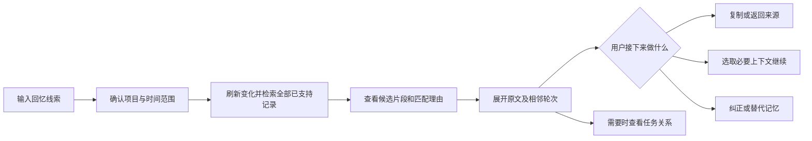
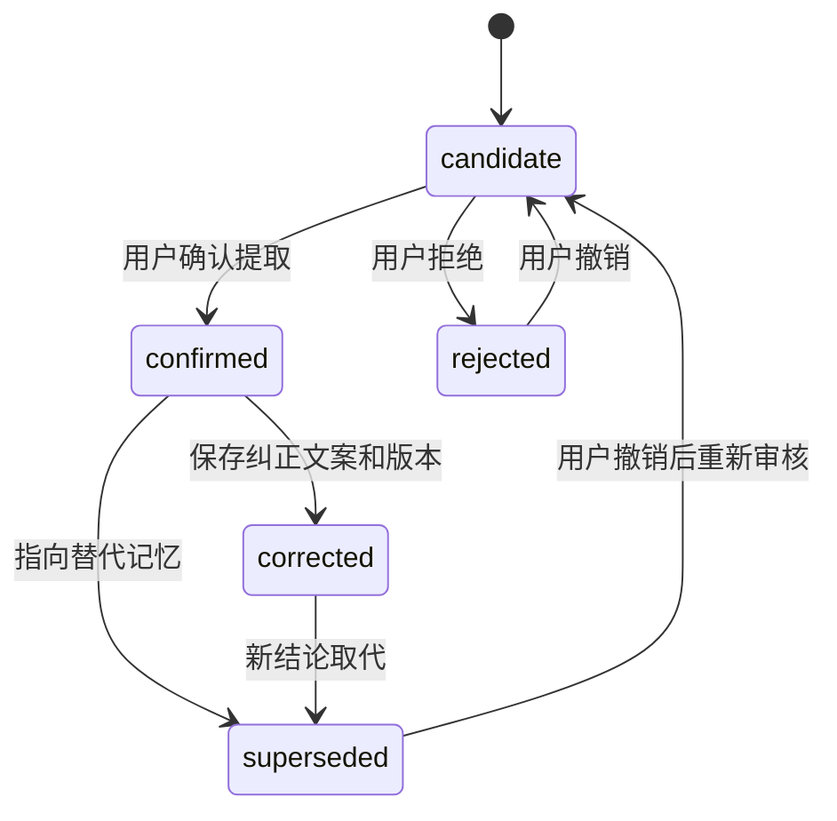

# MemoryGraph 优化方案与产品需求草案

版本：V0.3 方案稿。日期：2026-10-23。状态：供评审，尚未实施。

| 版本 | 日期 | 修订人 | 说明 |
| --- | --- | --- | --- |
| V0.3 方案稿 | 2026-10-23 | Codex | 基于社区调研和当前源码，提出优化范围、优先级与验收办法 |

## 一、概述：为什么优化

### 1.1 产品定位、用户和目标

建议定位：**帮助长期使用 Codex 的用户，从模糊记忆找回原始回答、核对出处，并带着必要上下文继续工作。**

用户首先应感受到“找到了、确认对了、能接着做”。任务关系图服务于理解来源与分歧，作为检索后的辅助视图。

背景依据：社区里存在按内容找会话、重复解释、手工维护交接文档、旧记忆反复出现等行为；Codex 官方已确认实现跨项目正文搜索，因此基础搜索需要作为比较基线。[社区求助](https://www.reddit.com/r/ClaudeCode/comments/1voffc7/have_you_ever_tried_to_find_an_old_claude_code/)、[旧记忆反馈](https://www.reddit.com/r/codex/comments/1verd5i/i_built_an_opensource_memory_layer_for_codex_that/)、[官方实现确认](https://github.com/openai/codex/issues/16672)。更多材料见 [前序调研](</Users/ethanshen/Desktop/LLM/untitled folder/MemoryGraph/research/2026-10-23-memorygraph-demand-research.zh-CN.md>)。

这些证据支持问题存在，尚未证明图谱偏好、整体发生率或付费意愿。

**[假设 A1] 首期继续聚焦 Codex 本地历史。** 优先用户是长期维护项目、经常回访规划和调试记录、已经尝试日志检索或笔记的人。跨工具与团队协作留到核心价值验证之后。

| 层面 | 目标 | 建议衡量办法 |
| --- | --- | --- |
| 用户 | 更快找回正确原文 | 成功率、完成时间、打开的候选数量 |
| 用户 | 能判断来源与适用性 | 原文核对正确率；是否把过时结论误当现状 |
| 产品 | 相比现有办法值得持续使用 | 与官方搜索/用户当前办法对比；两周后的再次使用 |
| 工程 | 搜索和审核行为可靠 | 搜索范围可解释；来源完整；反馈落盘与重启一致 |

### 1.2 名词与权限

原始记录指当时的用户问题和助手回答；检索片段是原文的一部分；记忆是从记录提取的派生内容；“已确认记忆”表示用户确认了这条提取，不自动表示它仍适用于当前代码。

| 角色/组件 | 权限与责任 |
| --- | --- |
| 本机用户 | 选择项目范围、查看原文、确认或纠正记忆、决定如何继续 |
| Codex / 检索工具 | 在选定范围内检索，返回来源与能力限制；自动提取只产生候选 |
| MemoryGraph | 源记录只读；写入自身索引、审核状态和显式导出的快照 |

文档供产品、研发、设计和测试评审。性能、排期、模型选择尚未形成承诺。

### 1.3 当前实现与真实缺口

以下依据当前工作区静态阅读，未执行端到端复现，也不是竞品性能结论。

| 当前实现 | 对用户的影响 | 优化方向 |
| --- | --- | --- |
| 已有原文配对、Turn 去重、来源信息、结果优先视图、反馈和候选审核 | 核心基础已存在 | 保留并补全，不重新开发同类入口 |
| `refreshMemoryIndex` 默认只扫 sessions 目录，按精确 cwd 隔离；README 写“跨项目” | 用户可能误解搜索覆盖；归档等来源未默认纳入 | 明确范围；补来源发现与覆盖状态 |
| `scoreRecord` 是关键词/词片段加权，正常索引搜索报告的 semanticMatches 为 0 | 换词、中英混合和模糊回忆容易漏掉 | 先优化词法，再按评测决定是否加本地语义检索 |
| 面板搜索框对本次图数据做筛选；后台默认只返回 8 条、最多 20 条 | 换关键词时，可能只在旧候选里找，误以为查了全历史 | 全库搜索与本页筛选分开；增加分页 |
| 索引把回答截到 20,000 字符；图数据也限长；继续请求另截到 5,000 字符 | “原始回答”可能不完整，尾部结论可能无法检索或传递 | 原文按需读取，明确片段与全文边界 |
| 后台先选 Top K，再应用用户反馈；structured results 未同步应用图上的反馈调整 | 被拒结果可能挤掉好结果；模型和界面可能看到不同排序 | 在选候选前应用反馈；统一结果模型 |
| 审核支持 corrected / superseded 状态，但面板主要暴露确认、拒绝、重置；状态存储覆盖旧值 | 修正与替代流程不完整，缺少版本链 | 增加编辑、替代目标和审核事件记录 |
| 面板先本地更新，工具调用失败可返回 null，调用方仍展示成功提示 | 用户可能误以为状态已经持久保存 | 区分待保存、已保存、仅页面保存和失败 |
| shared-prefix 依据 Turn ID 交集推断；规范化字段还存在长度上限 | “共同前缀”和“最早来源”的表述可能过强；长标题可能变化 | 验证有序前缀；保留完整标题和最早已知出处 |

源码入口：[索引](</Users/ethanshen/Desktop/LLM/untitled folder/MemoryGraph/mcp/memory-index.mjs>)、[工具与结果输出](</Users/ethanshen/Desktop/LLM/untitled folder/MemoryGraph/mcp/server.mjs>)、[持久状态](</Users/ethanshen/Desktop/LLM/untitled folder/MemoryGraph/mcp/product-state.mjs>)、[图规范化](</Users/ethanshen/Desktop/LLM/untitled folder/MemoryGraph/mcp/graph.mjs>)、[界面](</Users/ethanshen/Desktop/LLM/untitled folder/MemoryGraph/assets/widget.html>)。

## 二、产品描述：先交付什么

### 2.1 核心使用过程

典型请求：“之前为什么决定不接入第三方 SMTP？我只记得聊过退信和退订。”

复杂流程：先校验范围，再分别检索原始查询与扩展词，合并候选、处理副本和用户反馈，最后统一排序与分页。没有结果时，提示扩大项目/时间范围、刷新或换线索；任何扩大范围都应让用户可见，不自动跨项目。

数据流：本地源文件 → 来源适配器 → 原文引用与检索索引 → 统一检索服务 → 列表/详情/关系视图。用户审核 → 审核事件存储 → 检索策略及继续请求。快照是导出的静态副本，不作为最新状态来源。

### 2.2 优先级和阶段

| 阶段 | 优先级 | 范围 | 进入下一阶段的条件 |
| --- | --- | --- | --- |
| A：可信找回 | P0 | 真正全库查询、覆盖说明、全文读取、来源核验、反馈一致性、可靠保存 | 核心正确性用例通过；可完成真实找回案例 |
| B：更好召回与复用 | P1 | 查询扩展、经评测有效的本地语义召回、记忆纠正/替代、上下文选择 | 相对阶段 A，真实案例成功率或耗时改善 |
| C：关系与扩展验证 | P2 | 共同前缀/分歧浏览、图与列表对照实验、一个跨工具适配器试点 | 用户确实需要关系或跨工具历史，收益可复现 |

**[假设 A2] 暂按单名熟悉仓库的开发者组织三个连续迭代。** 每个阶段可以独立发布，具体工期需在来源兼容性和宿主接口验证后估算。先完成 A 再重新评估 B；不把团队共享、云同步、全量自动记忆或复杂图布局作为首期范围。

### 2.3 页面框架与全局规则

保留现有中英文和结果优先模式。主界面由搜索区、候选列表、原文详情组成；关系视图通过“查看相关任务”进入。

搜索区包含：原始查询、项目范围、日期、归档范围、搜索按钮；高级选项折叠。默认当前项目，日期不限，包含已支持的活跃与归档历史。所有项目选项需要用户主动切换。

列表每页建议 10 条，支持加载更多与回退。保存查询、过滤条件和阅读位置。清空查询显示最近记录；大批记录使用虚拟列表。分页游标绑定索引版本，刷新后提示结果更新并重建游标。

| 状态 | 界面行为 |
| --- | --- |
| 无结果 | 显示当前范围、覆盖缺口，以及扩大范围/修改线索的操作 |
| 部分来源失败 | 返回可用结果，并显示“部分记录未检索”；支持重试 |
| 正在刷新 | 显示进度或已处理计数；旧结果注明刷新中 |
| 重复查询 | 相同请求复用；新查询取消旧请求，忽略迟到结果 |
| 保存失败 | 保留用户输入并允许重试；不显示已保存 |
| 静态快照 | 显示导出时间；无宿主能力的按钮明确反馈无法执行 |

## 三、功能需求：具体怎样优化

### 3.1 P0：搜索真正覆盖选定历史

**用户故事：** 作为记不清会话位置的用户，我希望一次搜索覆盖选定项目的已支持历史，以便不用猜标题和逐个打开。

前置条件：存在用户可读取的本地存档。后置条件：返回与查询和索引版本绑定的结果、覆盖摘要及分页信息。

| 控件/字段 | 默认与规则 | 反馈 |
| --- | --- | --- |
| 查询框 | 保留用户原句；建议上限 1,000 字符；空查询进入最近记录 | Enter/按钮发起后台检索；超长时保留输入并提示 |
| 范围 | 当前精确 cwd | 可选择多个项目；每条结果显示所属项目 |
| 日期 | 不限；按记录时间和用户时区解释 | 自然语言解析为可编辑筛选条件，不静默硬过滤 |
| 归档 | 包含可支持的归档记录 | 明确归档与活跃结果来源 |
| 本页筛选 | 独立入口，默认关闭 | 明确只过滤已加载结果 |

来源发现补充 archived_sessions；先核对目标 Codex 版本的文件类型，识别压缩、空文件、格式不支持、权限不足和解析失败。压缩记录如无法解码，应显示具体缺口，不能说“完整历史没有匹配”。cwd 映射、worktree 与父仓库合并必须作为显式设置，不靠相似路径猜测。

将检索结果与图数据分离。统一结果对象同时供 Codex 和界面使用；图按所选结果构建，不再决定搜索边界。排序使用匹配质量和反馈；时间作为次级因素。每页重复查询应有稳定排序。

验收：首次查询返回的 8 条中没有目标记录时，在面板换词可以找到此前未加载的目标；日期和项目组合过滤生效；不支持来源存在时显示 partial；当前项目查询无其他项目内容混入。

### 3.2 P0：原文完整、出处可核验

**用户故事：** 作为需要复用准确措辞的用户，我希望看到完整原话和相邻问答，能够确认它就是当时的回答。

前置条件：候选有有效来源引用。后置条件：展示源验证状态，并区分原文、片段和派生记忆。

列表展示命中原文片段、日期、任务原题和简短匹配理由。详情默认展示完整的一问一答，长文本按块加载，并提供前后各一轮的展开入口。原文保留源文本；仅在检索字段中进行 NFKC、大小写或空白归一化。不能用归一化文本冒充逐字原文。

索引保存全文检索数据或分块索引与原始位置，展示和复制通过按需读取原文完成。取消固定截断对可检索全文的影响；超过载荷上限时返回分页引用及明确的截断标识。哈希以完整原文计算。

去重需同时核对 Turn ID、角色和完整内容哈希。同 ID 内容冲突保留两个版本并标记；副本折叠仍可查看各来源。在来源未覆盖完整、时间相同或证据不足时，展示“最早已知出处”，不宣称绝对起源。标题数据保持原文，视觉层省略显示。

“打开来源”先做宿主能力检测。若只能打开任务，就提供准确摘录与 Turn ID，不显示“已跳到该轮”。源文件已删除或校验失败时，可展示带缓存标识的历史片段，但不得声称已实时核验。

验收：20,000 字符后的唯一短语能够被检索、阅读和完整复制；含全角符号的原文不被改写；副本和冲突版本不会丢失；来源不可用时仍有清晰说明。

### 3.3 P0 / P1：让反馈和记忆审核真正生效

**用户故事：** 作为发现错配或过时结论的用户，我希望明确纠正它，并知道修改已经保存。

前置条件：结果或记忆具有项目和来源身份。后置条件：审核事件保存、界面与后续检索一致，原始对话不变。

**P0：** 在候选截断前应用反馈，避免被拒候选占据 Top K。统一后台、structured results、界面排序。检索“不正确”仅表示本查询错配，不能推导这段原文在任何问题下都无效；同项目同查询默认排除，可展开“已排除结果”并撤销。

保存采用 pending → saved / failed 状态；仅收到后端成功结果才显示“已保存到本机”。仅写入浏览器缓存时显示“仅保存在此页面”，不能等同插件持久状态。重复点击使用幂等请求；多个窗口的过期修改应检测版本冲突，提示重新载入。

**P1：** 为记忆补齐“编辑纠正”“被新记忆替代”，要求填写新内容或替代目标，并保留理由、操作者和时间。候选审核与检索相关性反馈使用独立控件和术语。

纠正创建新修订，不覆写原始记录；旧修订继续可追溯。拒绝和已替代记忆默认不进入“继续工作”材料，历史检索仍能找到原始问答，展示其审核状态。若检测到矛盾，只能提出“可能冲突”，需用户确认，不能按时间自动判定新结论胜出。

验收：重启后拒绝行为保持；换查询不误伤原始记录；保存失败不冒成功提示；纠正前后均可查看；替代关系有目标且不能形成循环；重建索引不丢审核。

### 3.4 P1：改善模糊回忆检索

**用户故事：** 作为只记得意思的用户，我希望换一种说法也能找到原始回答，并理解为什么命中。

前置条件：阶段 A 的来源与检索服务可靠。后置条件：候选仍指向原始记录，明确词法、扩展词或语义命中。

先支持可解释的中英文别名、标点变体、错误码/路径识别与中文分词；保留原始查询单独召回。随后用固定评测集比较“词法 + 扩展”与“词法 + 本地向量召回”。只有增益明确才启用后者；具体模型和索引依赖为 [待确认 D1]。

建议先分别召回候选，再融合排名；有限候选可使用本地轻量重排。结果显示实际命中依据，不显示未经校准的“正确率 95%”。语义检索不可用时明确降级，词法通道继续工作。

匹配标签分开：字面命中、词法相关、语义相关、上下文补充。标题命中只代表标题包含线索，不等于回答已证实结论。词法相关不再统称上下文；语义结果不能被界面的 literal includes 再次过滤掉。

验收：固定评测中的换词、跨语言和约束回忆有可测改善；精确错误码检索不退步；语义服务失败时没有伪造语义结果；无答案案例允许明确返回零命中。

### 3.5 P1：带着选定上下文继续

**用户故事：** 作为找到了旧方案的用户，我希望带着正确片段和出处继续当前任务，减少重新解释。

前置条件：用户选中原始记录或审核过的记忆。后置条件：发送或复制一个可预览的继续请求，含来源引用与当前适用性说明。

保留“打开原任务”和“带入当前对话”两个明确动作。默认选中命中问答，可追加相邻轮次；发送前展示材料、来源和长度。较长材料分页或通过引用继续读取，不能静默截到 5,000 字符后当完整记录发送。

材料中分开列出：当时原文、确认/替代状态、尚待核对事项。历史文字作为证据，不能自动成为当前执行指令。请求 Codex 继续时先核对相关文件和约束；不把旧测试通过或旧结论确认等同当前仍有效。

无宿主发送能力时提供复制；缺少有效源记录时展示缓存状态和风险点。撤销预览不发送任何内容。

验收：用户能看见实际传递的材料；长文尾部不会无提示丢失；被替代记忆不默认带入；候选记忆不会被标成已确认事实；打开来源失败时可复制引用。

### 3.6 P2：用任务关系解释分歧

**用户故事：** 作为在多个分支试过不同方案的用户，我希望知道共同讨论到哪里结束、后来在哪条任务改了决定。

前置条件：至少有两个相关任务和可说明的关系证据。后置条件：显示关系、证据与不确定性；不改变任务归属。

先实现共同前缀和分歧的列表式对照，再评估图的附加收益。fork 只采用明确元数据；shared-prefix 验证有序轮次与内容一致性，单纯 Turn ID 交集仅显示共享记录；continuation 需要明确继续证据；内容相近用无向 related。证据不足时不连确定的父子线。

关系图聚焦当前命中任务与近邻；大范围结果继续分页，不因图节点上限丢失搜索结果。选择边可查看关系形成依据。用户可以从每个分歧点返回原文。

验收：没有明确 fork 元数据的两个相似任务不显示 fork；相同 Turn 集合但顺序不同不标共同前缀；图与列表比较在“找原话”和“理解分歧”两类任务中分别评估。

## 四、非功能、数据与实施边界

### 4.1 核心数据契约

以下为建议字段，需要兼容现有数据，不是已实现接口。

| 对象/字段 | 类型 | 必填 | 含义/示例 |
| --- | --- | --- | --- |
| SearchRequest.query | string | 是 | 用户原始查询；最近记录使用独立 browse 模式 |
| SearchRequest.scope | object | 是 | `{mode: "current", cwds: ["…"]}`；all 模式必须显式选择 |
| SearchRequest.filters | object | 否 | 日期、时区、归档范围；`Asia/Shanghai` |
| SearchRequest.cursor | string | 否 | 与 queryHash、filtersHash、indexVersion 绑定的不透明游标 |
| SearchResponse.coverage | object | 是 | 已扫/可读/失败/不支持计数、roots、刷新时间、partial、degraded 原因 |
| SearchResponse.results | array | 是 | 唯一有序结果源，模型与界面共用 |
| SearchResult.source | object | 是 | sourceKind、cwd、threadId、turnId、role、sourceRef、完整内容哈希 |
| SearchResult.match | object | 是 | matchType、原始命中区间、excerpt、reason；区间标明字符/字节单位 |
| RecordRead | object | 是 | 原始文本块、完整长度、下一块游标、验证状态、截断标志 |
| MemoryRevision | object | 是 | memoryId、revision、status、content、derivedFrom、supersededBy、reviewedAt |
| ReviewEvent | object | 是 | eventId、scope、对象、旧/新版本、原因、时间、幂等键 |

身份以来源、会话、轮次、角色建立稳定键；完整内容哈希识别版本。最早已知出处变化时不能让审核因显示归属变化丢失。旧 record ID 提供映射迁移，迁移失败可回退。

### 4.2 存储与可靠性

先分离原文读取、检索结果、图映射和审核策略，避免直接重写整个项目。索引新增字段需要版本迁移，旧版可重建；审核与反馈独立持久保存，迁移前生成可恢复副本。

[待确认 D2] 是否迁移 SQLite/FTS：先测当前数据规模、刷新时间与内存。若 JSON 索引无法满足分页、过滤、并发和性能目标，再采用 SQLite/FTS 与中文检索扩展；不为技术选型本身阻塞 P0 正确性改进。

源记录只读，默认本地计算；引入托管 embedding 需单独明确选择、发送内容和目的。快照标明静态性质、时间和内容范围。删除源文件后移除对应可搜索内容；是否仍保留已有用户导出文件与历史审核事件，应在设置中说明。缓存不冒充备份。

### 4.3 性能与统计

**[假设 A3] 下列为工程目标，必须先测基线，不能对外当实测数据。** 建议用一个声明配置的 Apple Silicon 开发机，10 万条问答、约 1GB 源文本进行固定测试；同时记录实际硬件、数据分布与峰值内存。

| 指标 | 建议目标 |
| --- | --- |
| 热索引词法搜索 | P95 ≤ 1 秒，含排序、过滤和第一页序列化，不含源扫描 |
| 选中结果到详情首块 | P95 ≤ 500ms |
| 本地混合检索 | 建议 P95 ≤ 2 秒；模型加载与冷启动单独记录 |
| 冷索引、变化文件刷新 | 显示进度与可取消；首轮测量后制定预算 |

只在用户主动开启的试用评测中记录本地事件，不默认新增远程上报。事件包括 search_submitted、results_ready、source_opened、retrieval_verified、review_saved、continue_sent、operation_failed；属性限制为耗时、数量、模式、匿名评测任务号和错误分类，不记录原始问题、回答和文件路径。source_opened 不等于成功找回，需用户核对或评测判定。

### 4.4 实施映射与验证

| 模块 | 建议改动 | 现有检查基础 |
| --- | --- | --- |
| memory-index.mjs | 来源发现、全文引用、稳定身份、查询/分页/候选融合 | probe-memory-index.mjs 增加长文、覆盖、冲突、范围与分页用例 |
| server.mjs | 统一结果、读取原文/上下文接口、能力和覆盖信息 | probe-mcp.mjs 验证模型与面板输出一致 |
| product-state.mjs | 排序前反馈策略、审核修订、幂等与并发冲突 | probe-product-state.mjs 验证拒绝、撤销、迁移和失败恢复 |
| graph.mjs | 新匹配类型、长标题/片段边界、关系证据 | 关系契约用例和图生成检查 |
| widget.html | 全库查询入口、分页、全文展开、保存状态与继续预览 | 实际宿主交互验证，涵盖失败和无桥接能力 |
| snapshot.mjs / 安装脚本 | 快照状态说明、迁移与兼容能力报告 | 现有快照和安装 probe |

此阶段交付的是方案，没有修改这些实现，也没有运行上述功能检查。开发时针对新增行为补回归；通过后用真实宿主验证查询、保存、读取与继续链路。

## 五、验收、试用与待确认项

### 5.1 发布前正确性门槛

P0 至少覆盖：全库换词命中、归档与不支持来源提示、跨项目隔离、长文尾部、逐字原文、来源不可用、同 ID 冲突、副本折叠、分页稳定、保存失败、重启后状态、迁移后反馈保持，以及模型和界面结果一致。任何结果不得虚构原话、标题、Turn ID 或跳转能力。

### 5.2 是否值得继续投入

先建立 40–60 个经许可脱敏或合成的测试案例，包含精确词、中文换词、中英混合、日期、否定约束、分支副本、过时结论、长文和明确无答案。由人标注正确原始记录与可接受副本；不能用新检索结果给自身生成正确标签。

**建议门槛，属于 [假设 A4]：** 有答案案例 Top-5 正确原文召回率 ≥ 80%；来源可核验案例的来源一致率 100%；无答案案例不输出虚构答案。逐类报告分子、分母与错误案例，避免平均值掩盖退步。

再邀请 5–8 名目标用户，每人提供 3 个近期真实案例，比较官方搜索、用户当前办法、MemoryGraph。记录软件版本，平衡工具使用顺序，采用难度匹配案例，避免同一道题第二次已经知道答案。建议继续投入条件：正确率不低于基线，完成时间中位数至少减少 30%，并观察两周后的再次使用。小样本仅用于产品取舍，不宣布统计显著或市场规模。

图谱单独做列表对照：若找回没有变快，仅在理解分歧上有效，就保留为辅助入口；若两类任务都无明确帮助，降低后续投入。语义检索同样按分类型增益决定是否默认启用。

### 5.3 待确认清单

| 项目 | 建议默认 | 是否阻塞当前方案 |
| --- | --- | --- |
| A1 目标范围 | 首期 Codex、本机单用户 | 否；跨工具为后续决策 |
| A2 资源与排期 | 一名熟悉仓库的开发者，三个连续迭代 | 不阻塞产品评审；阻塞承诺上线日 |
| A3 性能目标 | 先测基线，再据实际规模确定 | 不阻塞 P0 正确性；影响性能承诺 |
| A4 验证门槛 | Top-5 ≥ 80%，时间中位数改善 ≥ 30% | 不阻塞写方案；试用前应定稿 |
| D1 语义模型 | 先词法和扩展，默认本地；用评测选模型 | 只影响 P1 |
| D2 存储迁移 | 保持可迁移，规模证据不足时不先重构 | 只影响技术设计与工期 |
| D3 目标宿主版本和可用接口 | 开发先核对当前环境的原文读取、跳转、工具调用能力 | 影响相应功能实现；需保留降级路径 |

建议第一批开发任务：把面板搜索接到完整索引，修正覆盖和全文边界，统一反馈后的候选与结果，补齐保存失败状态。完成这批之后，就能开始检验插件是否比官方搜索更有用。
